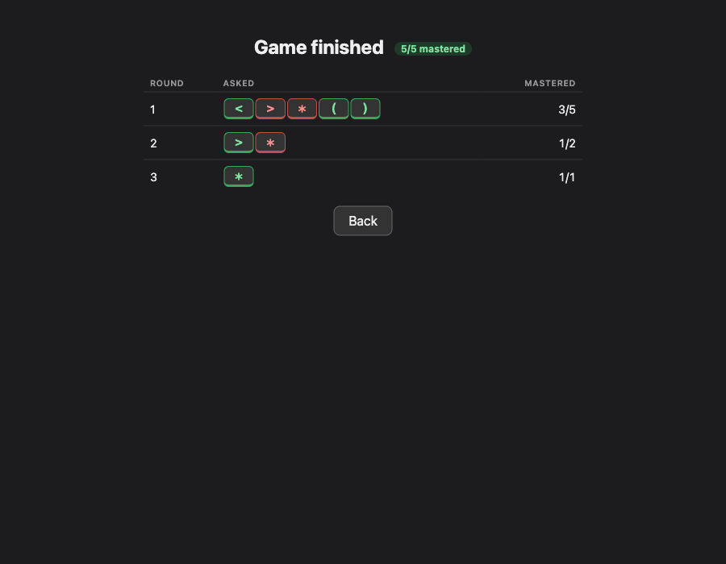
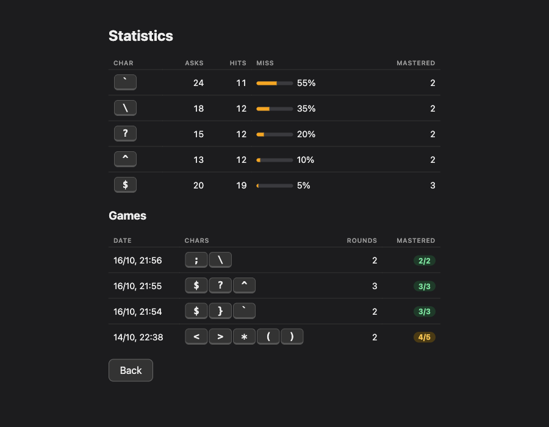

# symbolhu

A small desktop trainer built with **Tauri 2** and **Vue 3** for the symbols that are hard to find on a Hungarian Mac keyboard: `< > * ( ) [ ] { } \ | @ # & ~ ^ $` and more. It drills you on the characters you miss most, and shows exactly which keys to press when you get one wrong.


## Table of Contents

-   [Installation](#installation)
-   [Features](#features)
-   [Gallery](#gallery)
-   [Settings](#settings)
-   [Tech Stack](#tech-stack)
-   [Development](#development)
    -   [Prerequisites](#prerequisites)
    -   [Setup](#setup)
    -   [Commands](#commands)
    -   [Building](#building)
    -   [Releasing](#releasing)
    -   [Regenerating the layout map](#regenerating-the-layout-map)
-   [Project Structure](#project-structure)
-   [License](#license)

## Installation

Download the latest `.dmg` from the [releases page](https://github.com/esikgabi/symbolhu/releases) (macOS, Apple Silicon only), open it and drag **symbolhu** to Applications. You can also build it from source (see [Building](#building)).

The app is not notarized by Apple (no paid developer account), so macOS blocks the launch of every freshly downloaded version (including updates):

-   Try to open the app once, then go to **System Settings → Privacy & Security**, scroll down and click **Open Anyway**; or
-   run `xattr -dr com.apple.quarantine /Applications/symbolhu.app` in Terminal.

Repeat this after each new download. Releases are built by GitHub Actions from the tagged source, so the file you download matches the code in this repo.

## Features

-   **Weakness-driven games**: each game picks the 5 characters you miss most (miss rate over your last 30 asks); with no history it starts with `< > * ( )`.
-   **Rounds**: every active character is asked 3 times per round, shuffled, never the same one twice in a row. A character with all hits in a round is mastered and dropped; the game ends when none remain or after 10 rounds.
-   **Instant hints**: a wrong key or a 3 s timeout is a miss and shows the key combo on an on-screen keyboard. The hint stays until you press the right key (`Esc` skips it).
-   **Keycap display**: each symbol is drawn on a virtual key at its true height, so `'` `,` `-` `_` `.` are easy to tell apart.
-   **Round summary**: when a game ends, a table shows each round's asked characters (green = mastered, red = missed) and the overall result.
-   **Statistics**: per-character asks, hits, recent miss rate and times mastered, plus a game history.
-   **Configurable**: character pool, characters per game, timeout, hits per character and max rounds (all clamped to sane limits).
-   **Wrong input source detection**: warns when the Y/Z swap shows the Hungarian layout is not active.
-   **Local only**: data is saved on your machine via `tauri-plugin-store` (falls back to `localStorage` in the browser). No network, no telemetry.

## Gallery

### Menu


### Asking a symbol


### Game finished


### Statistics


### Settings


## Settings

The **Settings** screen controls what you practise and how strict each game is:

-   **Characters to practise (pool)**: every symbol that may show up in a game, typed as plain characters (spaces are ignored). Only characters that exist on the Hungarian layout are accepted; anything else is dropped on save. *Reset pool to all layout symbols* fills it with every symbol the layout map knows.
-   **Characters per game** (1-50, default 5): how many characters from the pool are drilled in one game. They are the weakest ones, ranked by miss rate over your last 30 asks.
-   **Timeout** (up to 60 s, default 3): how long you get to answer before it counts as a miss and the hint appears.
-   **Hits per character per round** (1-20, default 3): how many correct answers a character needs in a round to count as mastered.
-   **Max rounds** (1-100, default 10): the game ends after this many rounds even if some characters are not mastered yet.

Invalid or out-of-range values silently fall back to the defaults. Settings and statistics are stored locally and persist between runs.

## Tech Stack

-   **Core**: [Tauri 2](https://v2.tauri.app/) (Rust)
-   **Frontend**: [Vue 3](https://vuejs.org/) (Composition API, `<script setup>`) + [Vite](https://vitejs.dev/) + TypeScript
-   **Persistence**: [tauri-plugin-store](https://v2.tauri.app/plugin/store/)
-   **Tests**: [Vitest](https://vitest.dev/)
-   **Package manager**: [Bun](https://bun.sh/)

## Development

### Prerequisites

-   [Bun](https://bun.sh/): package manager and script runner (`curl -fsSL https://bun.sh/install | bash`).
-   [Rust](https://www.rust-lang.org/tools/install): stable toolchain via `rustup`, needed by Tauri.
-   Xcode Command Line Tools (`xcode-select --install`): C toolchain for Tauri on macOS. See the [Tauri prerequisites](https://v2.tauri.app/start/prerequisites/) for details.
-   The **Hungarian** input source enabled in macOS (System Settings → Keyboard → Input Sources), so the key hints match what you type.
-   *Optional*: `swiftc` (ships with the Xcode Command Line Tools), only to regenerate the layout map.

### Setup

```bash
git clone https://github.com/esikgabi/symbolhu.git
cd symbolhu
bun install
```

### Commands

```bash
bun run dev            # browser only, localStorage
bun run tauri dev      # native window
bun run test           # unit tests
bun run build          # type-check + production frontend build
```

### Building

```bash
bun run tauri build    # release .app and .dmg (Apple Silicon)
```

Output lands in `src-tauri/target/release/bundle/`.

> **Note:** `cargo check` needs the frontend output dir to exist: run `mkdir -p dist` first (`dist` is gitignored).

### Releasing

Versions follow [SemVer](https://semver.org/). `package.json`, `src-tauri/tauri.conf.json`, `src-tauri/Cargo.toml` and `src-tauri/Cargo.lock` must carry the same version. `scripts/bump.sh` updates all four (it uses macOS `sed`).

Steps for a new release (example: `0.3.0`):

```bash
# 1. branch from an up-to-date main and bump the version everywhere
git checkout main && git pull
git checkout -b chore/release-0.3.0
scripts/bump.sh 0.3.0
bun run test && bun run build        # sanity check

# 2. commit, push, open a PR and merge it into main
git commit -am "Bump version to 0.3.0"
git push -u origin HEAD

# 3. tag the merge commit on main and push the tag (this starts the release)
git checkout main && git pull
git tag v0.3.0 && git push origin v0.3.0
```

Tag only **after** the bump PR is merged: the workflow fails with `tag vX.Y.Z != vA.B.C` if the tag does not match the versions in the files. If that happens, delete the tag (`git tag -d vX.Y.Z && git push origin :refs/tags/vX.Y.Z`), merge the fix and tag again.

The [Release workflow](.github/workflows/release.yml) builds the Apple Silicon `.dmg` and attaches it to a **draft** GitHub release. Edit the notes, then click **Publish**. Use `0.x.y-rc.1` style tags/versions with the "pre-release" checkbox for test builds. The workflow can also be started manually from the Actions tab as a dry run.

### Regenerating the layout map

Needs the Hungarian input source enabled. Don't hand-edit the JSON; rerun the script:

```bash
swiftc -O scripts/gen-layout.swift -o /tmp/gen-layout && /tmp/gen-layout > src/data/layout-hu-mac.json
```

## Project Structure

-   `src/`: Vue frontend.
    -   `engine/`: pure game logic (queue building, weakness, `GameSession`, settings), unit-tested, no Vue/Tauri imports.
    -   `input/`: classifies a `KeyboardEvent` as hit, miss or ignored.
    -   `components/`: `Practice`, `Settings`, `Stats`, `KeyboardHint`.
    -   `data/layout-hu-mac.json`: character to physical key and modifiers (generated).
    -   `layout.ts`, `store.ts`: layout lookup and persistence.
-   `src-tauri/`: Rust shell, capabilities and Tauri config.
-   `scripts/`: layout generator (`gen-layout.swift`) and version bump (`bump.sh`).
-   `.github/workflows/`: release pipeline.
-   `docs/superpowers/`: design spec and implementation plan.
-   `screenshots/`: images used in this README.

## License

This project is licensed under the GNU General Public License v3 - see the [LICENSE](LICENSE) file for details.
